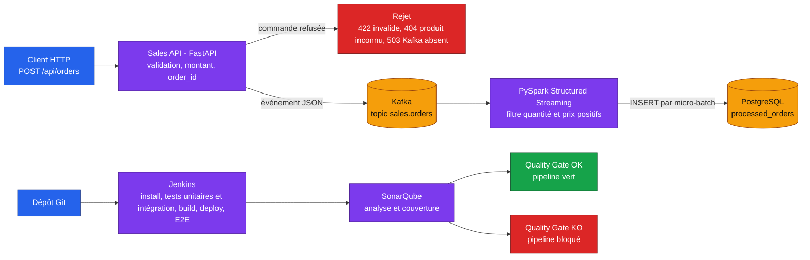

# TP Master Data Engineering - Real-Time Sales Analytics & DevOps

<!-- adam-badges:start -->
[](CHANGELOG.md)
[](https://github.com/Adam-Blf/real-time-sales-devops-tp/commits)
[](https://hits.sh/github.com/Adam-Blf/real-time-sales-devops-tp/)
[](https://github.com/Adam-Blf/real-time-sales-devops-tp/commits)
[](https://github.com/Adam-Blf/real-time-sales-devops-tp)
[](LICENSE)
<!-- adam-badges:end -->

Projet fil rouge : industrialiser une pipeline Big Data de ventes temps réel avec tests, Jenkins et SonarQube.

## Stack

- FastAPI : API REST de ventes
- Kafka : ingestion des événements
- PySpark : traitement streaming
- PostgreSQL : stockage des ventes traitées
- Jenkins : CI/CD
- SonarQube : analyse qualité
- Docker Compose : infrastructure reproductible
- Pytest : framework de tests

## Architecture



La pile complète tourne en local avec Docker Compose, et les manifestes de [k8s/](k8s/) la redéploient sur un cluster Kubernetes local.

## Travail réalisé (fork Adam Beloucif)

- Rapport PDF des deux TP : [docs/Rapport TP DevOps et Kubernetes - Adam Beloucif.pdf](<docs/Rapport TP DevOps et Kubernetes - Adam Beloucif.pdf>), régénérable avec `python docs/rapport/build.py`
- Rapport du TP CI/CD : [docs/report.md](docs/report.md) (tests, Jenkins, SonarQube, Quality Gate, résultats avant/après)
- Déploiement Kubernetes local : [docs/kubernetes.md](docs/kubernetes.md) et manifestes dans [k8s/](k8s/)
- Preuves brutes (sorties Jenkins, SonarQube, kubectl) : [docs/evidence/](docs/evidence/)

## 1. Prérequis étudiant

- Git
- Docker
- Docker Compose v2
- navigateur web

Aucune installation locale de Python, Java, Kafka, Spark ou PostgreSQL n'est nécessaire.

## 2. Démarrage de l'infrastructure

```bash
git clone <URL_DU_REPO>
cd real-time-sales-devops-tp

docker compose up -d --build
```

Vérifier :

```bash
docker compose ps
```

Services principaux :

| Service | Port | Usage |
|---|---:|---|
| Sales API | 8000 | API REST |
| PostgreSQL | 5432 | base de données |
| Kafka | 9092 | streaming |
| Spark Master UI | 8080 | interface Spark |
| Spark Worker UI | 8081 | interface Worker |
| Jenkins | 8082 | CI/CD |
| SonarQube | 9000 | qualité |

## 3. Vérifications

API :

```text
http://localhost:8000/docs
```

Health :

```bash
curl http://localhost:8000/api/health
```

Produits :

```bash
curl http://localhost:8000/api/products
```

Spark :

```text
http://localhost:8080
```

Jenkins :

```text
http://localhost:8082
```

SonarQube :

```text
http://localhost:9000
```

## 4. Générer une commande

```bash
curl -X POST http://localhost:8000/api/orders \
  -H "Content-Type: application/json" \
  -d '{
    "customer_id": "C001",
    "product_id": "P001",
    "quantity": 2,
    "unit_price": 49.90
  }'
```

L'API publie l'événement dans Kafka.

## 5. Sujet du TP

Les étudiants doivent industrialiser cette application.

### Partie A - Tests unitaires

Créer des tests dans :

```text
tests/unit/
```

Objectifs :

- tester les règles métier ;
- tester les validations ;
- tester les calculs ;
- atteindre une couverture définie par l'enseignant.

### Partie B - Tests d'intégration

Créer :

```text
tests/integration/
```

Tester les interactions :

```text
API -> Kafka
Spark -> PostgreSQL
```

### Partie C - Tests E2E

Créer :

```text
tests/e2e/
```

Tester le scénario complet :

```text
POST order
   -> Kafka
   -> Spark
   -> PostgreSQL
   -> vérification
```

### Partie D - Jenkins

Compléter/améliorer :

```text
Jenkinsfile
```

Pipeline attendue :

```text
Checkout
  ↓
Install
  ↓
Lint
  ↓
Unit Tests
  ↓
Integration Tests
  ↓
Build
  ↓
E2E Tests
  ↓
SonarQube
  ↓
Quality Gate
```

### Partie E - SonarQube

Configurer le projet afin d'analyser :

- Bugs
- Vulnerabilities
- Code Smells
- Coverage
- Duplications

Le pipeline doit être bloqué si le Quality Gate échoue.

## 6. Règle pédagogique importante

Ne modifiez pas l'infrastructure au début du TP.

Le rôle des étudiants est d'abord de travailler sur :

```text
tests/
Jenkinsfile
sonar-project.properties
```

Puis, dans une deuxième étape, ils peuvent améliorer le code et l'infrastructure.

## 7. Livrables

1. Repository GitLab
2. Tests unitaires
3. Tests d'intégration
4. Tests E2E
5. Jenkinsfile
6. Configuration SonarQube
7. Rapport de couverture
8. Capture Jenkins
9. Capture SonarQube
10. Documentation courte

## 8. Arrêt

```bash
docker compose down
```

Pour supprimer aussi les volumes :

```bash
docker compose down -v
```

## Licence

MIT, voir [LICENSE](LICENSE). Elle couvre le travail réalisé dans ce fork (tests, Jenkins, SonarQube, Kubernetes, rapport). Le squelette initial du TP fourni avec le sujet reste à son auteur.
