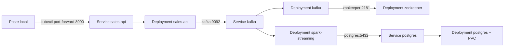

# Déploiement Kubernetes local (Minikube)

Compte rendu du TP « Déployer une pipeline Data avec Kubernetes en local ». Manifestes dans [`k8s/`](../k8s/), sorties brutes dans [`evidence/`](evidence/) (fichiers `k8s-*`).

## Architecture déployée



Tout vit dans le namespace `sales`, ce qui isole la plateforme des autres déploiements du cluster.

| Fichier | Ressources |
|---|---|
| `00-namespace.yaml` | Namespace `sales` |
| `01-configmap.yaml` | ConfigMap `sales-config` : hôtes Kafka et PostgreSQL, topic, base, utilisateur |
| `02-postgres-init.yaml` | ConfigMap du script `init.sql`, monté dans `docker-entrypoint-initdb.d` |
| `postgres.yaml` | PVC 1 Gi, Deployment (stratégie `Recreate`), Service `postgres` |
| `kafka.yaml` | Deployments et Services `zookeeper` et `kafka`, Job `kafka-init` qui crée le topic |
| `api-deployment.yaml` | Deployment `sales-api`, sondes sur `/api/health` |
| `api-service.yaml` | Service `sales-api`, port 8000 |
| `spark-streaming.yaml` | PVC des checkpoints, Deployment `spark-streaming` |

## Adaptations par rapport à Docker Compose

- **Noms DNS.** Les composants joignent les Services Kubernetes (`kafka:9092`, `postgres:5432`), centralisés dans la ConfigMap. Kafka n'a plus qu'un listener, puisque tous ses clients sont dans le cluster.
- **Secret hors Git.** Le mot de passe PostgreSQL est dans le Secret `postgres-credentials`, créé à la main avec une valeur aléatoire (voir `k8s/README.md`). Aucun manifeste ne contient de mot de passe.
- **`enableServiceLinks: false`.** Kubernetes injecte par défaut des variables comme `KAFKA_PORT=tcp://10.x.x.x:9092` pour chaque Service. Les images Confluent lisent toute variable `KAFKA_*` ou `ZOOKEEPER_*` comme un réglage et refusent de démarrer. Désactiver ces liens règle le problème.
- **Spark en mode local.** Le Deployment `spark-streaming` lance le même job, avec la même image, en `--master local[2]`. Il remplace le couple master et worker du compose, trop lourd pour un nœud Minikube. Si le topic manque, le job s'arrête et Kubernetes relance le conteneur.
- **Images locales.** `sales-api:tp3` et `sales-spark-streaming:tp3` sont construites dans Minikube (`minikube image build`) et déclarées en `imagePullPolicy: Never`.
- **Persistance.** PostgreSQL et les checkpoints Spark ont chacun un PersistentVolumeClaim.

## État du cluster

Sortie complète : `evidence/k8s-01-etat-initial.txt`.

```text
NAME                              READY   UP-TO-DATE   AVAILABLE
deployment.apps/kafka             1/1     1            1
deployment.apps/postgres          1/1     1            1
deployment.apps/sales-api         1/1     1            1
deployment.apps/spark-streaming   1/1     1            1
deployment.apps/zookeeper         1/1     1            1

NAME                TYPE        PORT(S)
service/kafka       ClusterIP   9092/TCP
service/postgres    ClusterIP   5432/TCP
service/sales-api   ClusterIP   8000/TCP
service/zookeeper   ClusterIP   2181/TCP
```

Le Pod du Job `kafka-init` est en `Completed` : le topic a été créé.

## Test de l'API et du flux de données

Avec `kubectl -n sales port-forward service/sales-api 8000:8000` (`evidence/k8s-02-test-api.txt`) :

```text
$ curl http://localhost:8000/api/health
{"status":"UP","service":"sales-api"}
$ curl -X POST http://localhost:8000/api/orders -d '{"customer_id":"C100","product_id":"P001","quantity":3,"unit_price":100}'
{"customer_id":"C100","product_id":"P001","quantity":3,"unit_price":100.0,"order_id":"ORD-34A3DCF77E","total_amount":300.0,...}
```

La commande a traversé Kafka et Spark et se retrouve en base six secondes plus tard (`evidence/k8s-03-flux-postgres.txt`) :

```text
    order_id    | customer_id | product_id | quantity | unit_price | total_amount
----------------+-------------+------------+----------+------------+--------------
 ORD-34A3DCF77E | C100        | P001       |        3 |     100.00 |       300.00
```

## Mise à l'échelle

`kubectl scale deployment/sales-api --replicas=3` a créé deux Pods supplémentaires, prêts en quelques secondes, et le Deployment est passé à `3/3`. Le Service `sales-api` répartit alors les requêtes entre les trois Pods. Le retour à `--replicas=1` a supprimé les deux Pods en trop (`evidence/k8s-04-scaling.txt`).

## Suppression d'un Pod

Après `kubectl delete pod sales-api-b5db74958-8lqzt`, le ReplicaSet du Deployment a constaté qu'il ne restait plus que 0 Pod pour 1 souhaité et a créé `sales-api-b5db74958-g4j5d` dans la même seconde, avant même la fin de l'arrêt de l'ancien. Le nouveau Pod est devenu prêt 7 secondes plus tard, dès que sa sonde `/api/health` a répondu. Kubernetes ne relance pas « le même » Pod : il en crée un nouveau, avec un autre nom et une autre IP, pour revenir à l'état déclaré. C'est pourquoi on passe toujours par le Service, dont l'adresse reste stable (`evidence/k8s-05-suppression-pod.txt`).

## Problèmes rencontrés

| Symptôme | Cause | Correction |
|---|---|---|
| Kafka redémarrait en boucle | sonde de disponibilité `kafka-topics` : une JVM complète qui dépassait 10 s sur un nœud chargé, puis `NodeExists` dans ZooKeeper au redémarrage | sonde TCP sur le port 9092 |
| Images Confluent qui refusent de démarrer | variables `KAFKA_PORT` et `ZOOKEEPER_PORT` injectées par les Services | `enableServiceLinks: false` |
| Cluster Minikube déjà occupé par un autre cours | déploiements existants dans `default` | namespace `sales` dédié, rien n'a été modifié hors de ce namespace |

## Nettoyage

```bash
kubectl delete -f k8s/
minikube stop
```
