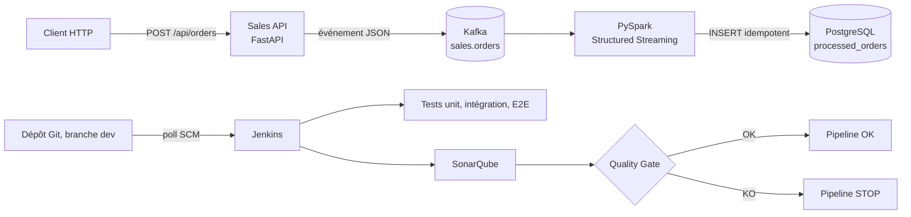

# Rapport - Industrialisation de la pipeline Real-Time Sales

Auteur : Adam Beloucif, Master Data Engineering (EFREI)
Branche de travail : `dev`, dépôt https://github.com/Adam-Blf/real-time-sales-devops-tp

Ce rapport couvre le TP « Industrialisation d'une pipeline Big Data avec CI/CD ». Le déploiement Kubernetes du TP suivant est décrit dans [kubernetes.md](kubernetes.md). Les sorties brutes citées ici sont dans [evidence/](evidence/).

## Architecture du projet



L'API valide la commande, calcule le montant et publie un événement dans `sales.orders`. Le job Spark lit le topic, filtre les événements invalides et écrit dans `processed_orders`. Toute l'infrastructure tourne avec `docker compose up -d --build`, Jenkins et SonarQube compris.

Le code applicatif a été découpé pour être testable :

| Module | Rôle |
|---|---|
| `app/domain.py` | règles métier pures : modèle `Order`, catalogue, calcul du montant, identifiant, construction de l'événement |
| `app/messaging.py` | producteur Kafka unique partagé entre les requêtes, fermé à l'arrêt de l'API |
| `app/main.py` | routes HTTP ; 404 si produit inconnu, 422 si données invalides, 503 si Kafka est indisponible |
| `spark/sales_stream.py` | job streaming, insertion idempotente, checkpoint sur volume |

## Stratégie de tests

Trois niveaux, du plus rapide au plus réaliste. Chaque niveau tourne en étape séparée dans Jenkins, et un échec arrête la pipeline.

| Niveau | Dossier | Dépendances | Durée | Nombre |
|---|---|---|---|---|
| Unitaire | `tests/unit/` | aucune (Kafka simulé) | ~1,5 s | 50 |
| Intégration | `tests/integration/` | vrais services Docker | ~8 s | 5 |
| End-to-End | `tests/e2e/` | plateforme complète | ~1,5 s | 1 |

Les tests d'intégration et E2E n'utilisent aucun `time.sleep` fixe. Ils passent par `tests/support/polling.py` : `wait_for()` interroge la condition à intervalle régulier et lève `PollingTimeout` avec la dernière erreur dès que le délai est dépassé. Le test échoue donc proprement, avec un message qui dit ce qui manquait.

Les adresses des services viennent de variables d'environnement (`tests/support/settings.py`), si bien que les mêmes tests tournent depuis le poste (ports publiés) et depuis Jenkins (noms des services Compose).

## Tests unitaires réalisés

Fichier principal : `tests/unit/test_domain.py`, complété par `test_api_routes.py`, `test_messaging.py` et `test_polling.py`.

| Cas demandé | Tests |
|---|---|
| Calcul du montant total | 5 cas paramétrés, dont `3 x 100 = 300` et `3 x 0,1 = 0,3`, plus l'arrondi au centime |
| Quantité positive | quantité 1 acceptée, borne haute 1000 incluse |
| Quantité nulle ou négative | 0, -1, -50 et 1001 refusés, quantité non numérique refusée |
| Prix positif | 0,01, 49,9 et 100000 acceptés |
| Prix invalide | 0, -10, 100000,01 et une chaîne refusés |
| Identifiants client et produit | vides ou d'un seul caractère refusés, champ absent refusé |
| Identifiant de commande | format `ORD-` suivi de 10 hexadécimaux majuscules, unicité sur 1000 tirages |
| Construction de l'événement | tous les champs présents, valeurs recopiées, horodatage ISO 8601 avec fuseau |
| Routes HTTP | santé, catalogue, commande valide publiée, 404 sans publication, 422 sur 4 charges invalides, 503 si Kafka tombe |

Couverture du paquet `app` : **100 %** (rapport `coverage.xml` publié dans SonarQube).

## Tests d'intégration réalisés

**Test A - API vers Kafka** (`tests/integration/test_api_kafka.py`). Une commande est postée à l'API réelle. Un consommateur Kafka, dans un groupe neuf à chaque test, lit le topic et attend l'événement portant le même `order_id`, puis le test compare client, produit, quantité et montant (`4 x 89,90 = 359,6`). Deux autres tests vérifient que l'API répond et qu'un produit inconnu est refusé en 404 (l'absence de publication dans ce cas est prouvée au niveau unitaire).

**Test B - Kafka vers Spark vers PostgreSQL** (`tests/integration/test_spark_postgres.py`). Le test écrit directement un événement dans Kafka, sans passer par l'API, puis attend la ligne correspondante dans `processed_orders`. Un second test publie un événement invalide (quantité négative) suivi d'un marqueur valide : quand le marqueur est en base, Spark a forcément traité l'événement invalide, qui doit être absent. Cela prouve le filtrage sans attente arbitraire.

## Scénario E2E

`tests/e2e/test_sales_pipeline.py`, écrit en Given / When / Then :

- **Given** l'infrastructure démarrée (l'API répond sur `/api/health`).
- **When** la commande `{"customer_id": "C100", "product_id": "P001", "quantity": 3, "unit_price": 100}` est envoyée à l'API.
- **Then** elle est publiée, consommée, traitée et enregistrée : la ligne en base a le bon client, le bon produit, la bonne quantité et un montant de **300**.

## Pipeline Jenkins

Jenkins est entièrement décrit en code : image `docker/jenkins/Dockerfile` (CLI Docker, Python, plugins de `plugins.txt`) et configuration `docker/jenkins/casc.yaml` (compte admin, identifiant `sonar-token`, job `real-time-sales-pipeline` créé au démarrage et branché sur la branche `dev` avec un poll SCM toutes les deux minutes). Aucun clic dans l'interface n'est nécessaire.

Étapes du `Jenkinsfile` :

```text
Checkout -> Install -> Unit Tests -> Integration Tests -> Build -> Deploy -> E2E Tests -> SonarQube Analysis -> Quality Gate
```

- **Install** crée un environnement virtuel dans le workspace.
- **Build** reconstruit les images `sales-api` et `spark-streaming`, **Deploy** les redémarre, pour que l'E2E valide exactement le commit en cours.
- **SonarQube Analysis** lance `sonar-scanner-cli` dans un conteneur frère qui partage le workspace (`--volumes-from`).
- **Quality Gate** exécute `tools/quality_gate.py`, qui attend la fin du traitement côté serveur, affiche chaque condition et renvoie un code d'erreur si le Gate n'est pas OK.
- Les rapports JUnit des trois niveaux et `coverage.xml` sont archivés à chaque build.

Résultat du build #3 (sortie complète : `evidence/jenkins-build-3-success.log`) :

```text
Unit Tests          50 passed
Integration Tests    5 passed
E2E Tests            1 passed
Quality Gate: OK
Pipeline OK: tests green and Quality Gate passed.
Finished: SUCCESS
```

## Configuration SonarQube

`sonar-project.properties` analyse `app`, `spark` et `tools`, déclare `tests` comme code de test et lit `coverage.xml` et le rapport JUnit. Le job Spark et l'outillage CI sont exclus du calcul de couverture : ils sont validés par les tests d'intégration et E2E et par Jenkins lui-même, pas par des tests unitaires.

`tools/sonar_setup.py` configure le serveur une seule fois par l'API web : création du projet, du Quality Gate et d'un jeton d'analyse écrit dans `.env` (ignoré par Git), d'où Compose le transmet à Jenkins.

## Quality Gate

Gate `Data Pipeline Gate`, appliqué à tout le code du projet :

| Condition | Seuil |
|---|---|
| Couverture | >= 80 % |
| Bugs | = 0 |
| Vulnérabilités | = 0 |
| Duplications | <= 3 % |

## Résultats obtenus

Pour mesurer l'amélioration, le code d'origine de l'enseignant (commit `84fc384`, avec ses 3 tests de départ) a été analysé avec le même Gate, dans un projet séparé (`evidence/sonar-quality-gates.txt`).

| Mesure | Code d'origine | Après le TP |
|---|---|---|
| Couverture | 70,7 % | **100 %** |
| Bugs | 0 | 0 |
| Vulnérabilités | 1 (critique) | **0** |
| Code smells | 0 | 0 |
| Duplications | 0 % | 0 % |
| **Quality Gate** | **ERROR** | **OK** |

Classement des problèmes relevés sur le code d'origine :

- **Vulnerabilities** : `spark/sales_stream.py`, checkpoint dans `/tmp`, répertoire accessible en écriture à tous (règle « publicly writable directories »).
- **Coverage** : 70,7 %, sous le seuil de 80 %, les règles de validation n'étant pas toutes testées.
- **Bugs, Code Smells, Duplications** : aucun.

## Problèmes rencontrés et corrections réalisées

| Problème | Cause | Correction |
|---|---|---|
| Le job Spark mourait au premier démarrage | Spark s'abonnait avant la création du topic (`UnknownTopicOrPartitionException`) | service `kafka-init` qui crée le topic, Spark démarre après lui, `restart: on-failure` |
| Doublons de clé primaire après un redémarrage | checkpoint en `/tmp` perdu, relecture depuis `earliest` | checkpoint sur volume nommé et `INSERT ... ON CONFLICT DO NOTHING` |
| Échec d'écriture depuis les exécuteurs | l'image `apache/spark` des exécuteurs n'a pas `psycopg2` | insertion côté driver, partition par partition (`toLocalIterator`) |
| Un producteur Kafka ouvert par requête | création dans la route | producteur unique partagé, fermé à l'arrêt, erreur Kafka convertie en 503 |
| Vulnérabilité Sonar sur `/tmp` | voir ci-dessus | chemin de checkpoint configurable, par défaut `/opt/spark-checkpoints` |
| SonarQube 26.10 refusait `admin/admin` | compte initial sans mot de passe utilisable | réinitialisation documentée par Sonar, puis mot de passe aléatoire posé par l'API et rangé dans `.env` |
| Jenkins ignorait sa configuration | `casc.yaml` copié dans `/var/jenkins_home`, masqué par le volume | fichier déplacé dans `/opt/jenkins-casc` |
| Build #2 en échec à l'étape Quality Gate | l'image du scanner écrit dans `/tmp/.scannerwork`, perdu avec `--rm` | `sonar.working.directory` dans le workspace ; build #3 vert |
| Kafka ne redémarrait pas après un arrêt brutal de Docker | nœud éphémère du broker encore présent dans ZooKeeper (`NodeExists`) | `restart: on-failure` sur Kafka |

Le build #2 montre aussi que la pipeline s'arrête réellement : les tests étaient verts, mais l'étape Quality Gate a échoué et Jenkins a marqué le build en **FAILURE** (`evidence/jenkins-build-2-failure.log`).

## Reproduire

```bash
docker compose up -d --build
python tools/sonar_setup.py          # une fois, après le premier démarrage de SonarQube
docker compose up -d jenkins         # recharge le jeton écrit dans .env
pytest tests/unit --cov=app          # en local
pytest tests/integration tests/e2e   # plateforme démarrée
```

Jenkins : http://localhost:8082 (compte `admin`, mot de passe `JENKINS_ADMIN_PASSWORD` du fichier `.env`). SonarQube : http://localhost:9000.
